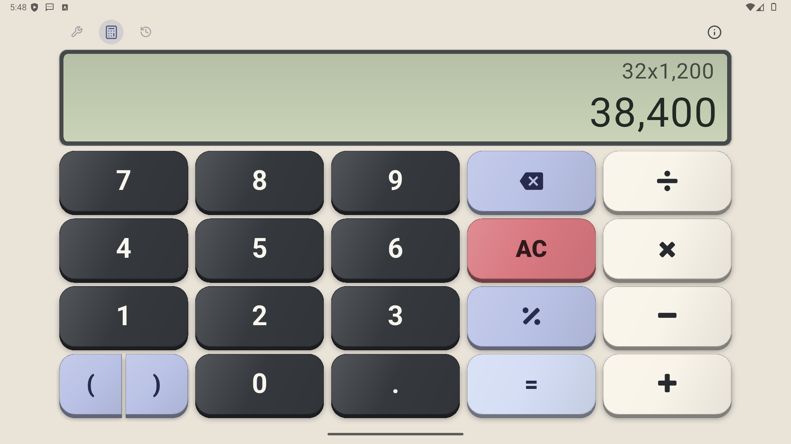

# Keycap Calc

一款用 Flutter 开发的安卓计算器，支持横竖屏布局、实体机配色、自定义键帽质感和圆角。

## 界面截图

截图使用 **米白商务（Ivory Desk）**、**3D Keycap** 和 **25 dp** 按键圆角。

### 横屏



### 竖屏


## 功能

- **竖屏四列，横屏五列**，旋转屏幕时保留当前算式。
- **浅色、深色和系统模式**可切换，实体机主题有独立的键帽配色和 LCD 风格显示区。
- **五种按键质感**包括 Original、Flat、2.5D Keycap、3D Keycap 和 Frosted Glass，圆角和字体可分别设置。
- **实时显示结果**，支持括号、百分比和历史记录。短按退格删除一位，长按清空当前算式。

## 本地运行

已用 Flutter 3.32.8、JDK 17 和 Android SDK Platform 35 验证构建。连接 Android 设备或启动模拟器后运行以下命令。

```bash
git clone https://github.com/a114126541/keycap-calc.git
cd keycap-calc
flutter pub get
flutter run
```

运行 `flutter test` 执行测试。使用 `flutter build apk --release` 构建 APK，输出位于 `build/app/outputs/flutter-apk/`。

若要和原版同时安装，可以构建使用独立包名的预览 APK。

```bash
ORG_GRADLE_PROJECT_calculatorPreview=true flutter build apk --release --target-platform android-arm64
```

## 开源许可与署名

Keycap Calc 由 gospursgo 维护，基于 Mohammed Ragheb 开发的 Neumorphic Calculator。[维护者](https://github.com/a114126541) · [上游项目](https://github.com/mllrr96/Neumorphic-Calculator)

原作者版权声明为 **Copyright (c) 2024 Mohammed Ragheb**。仓库根目录保留了该声明和完整 MIT 许可文本。[LICENSE](LICENSE)
