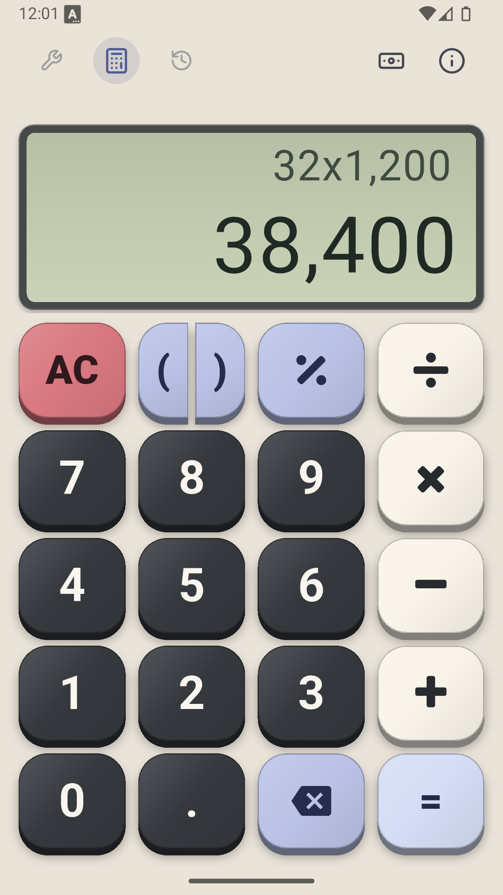
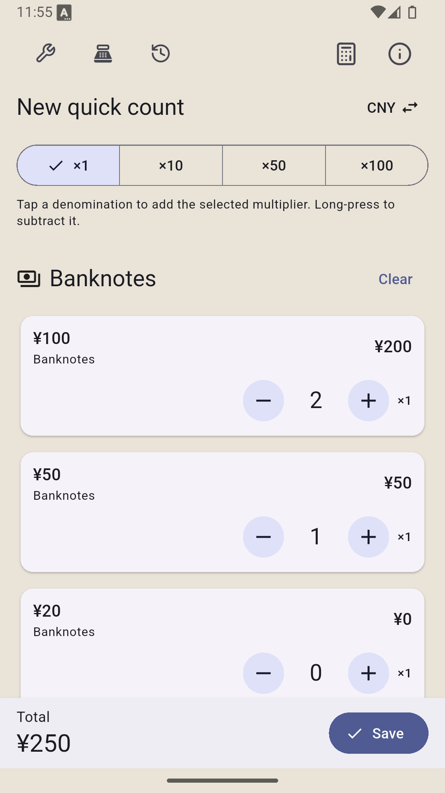
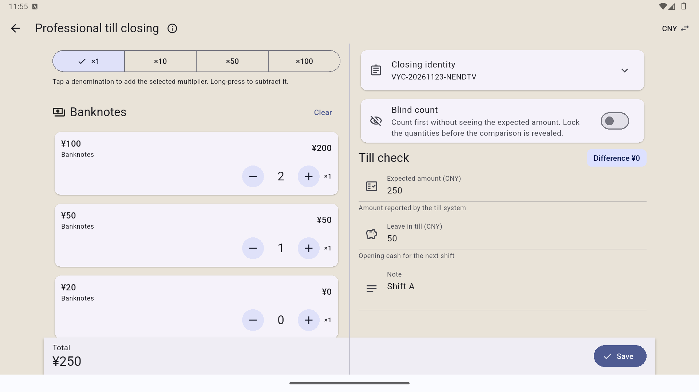

# Keycap Calc

English · [简体中文](README.zh-CN.md)

Keycap Calc is an Android calculator and cash tally app built with Flutter. It has portrait and landscape layouts, themes inspired by physical calculators, and settings for key style and corner radius.

## Screenshots

The screenshots show **Ivory Desk** with the **3D Keycap** style and a **25 dp** corner radius.

### Landscape


### Portrait



## Features

- **Four columns in portrait and five in landscape.** Rotating the screen keeps the current expression.
- **Light, dark, and system modes.** Themes inspired by physical calculators have their own key colors and LCD-style displays.
- **Five key styles** include Original, Flat, 2.5D Keycap, 3D Keycap, and Frosted Glass. Set the corner radius and font separately.
- **Live results**, parentheses, percentages, and calculation history. Tap Backspace to delete one character or hold it to clear the expression.
- **Cash tally** for quick counts and till closing. [Cash tally features and screenshots](#cash-tally)

## Cash tally

Tap the banknote button next to About to open **New quick count**. Count banknotes and coins by denomination, enter quantities in steps of ×1, ×10, ×50 or ×100, and save the count with a note. The currency code and switch button are in the top-right corner.

Tap the cash register button to start **Professional till closing**. Compare counted cash with the expected amount, record the float, import a POS report, and capture signatures. Blind counting hides the expected amount and difference until you lock the count. Saved closings can be exported as PDF or CSV.

In **Cash tally settings**, set the region and default currency, edit denominations, and save business details and till templates. Available currencies include CNY, HKD, MOP and TWD. You can export an encrypted backup and restore counts and settings from it.

### Quick count in portrait



### Professional till closing in landscape



## Run locally

The build has been tested with Flutter 3.32.8, JDK 17, and Android SDK Platform 35. Connect an Android device or start an emulator, then run these commands.

```bash
git clone https://github.com/a114126541/keycap-calc.git
cd keycap-calc
flutter pub get
flutter run
```

Use `flutter test` to run the test suite. `flutter build apk --release` saves the APK in `build/app/outputs/flutter-apk/`.

To install Keycap Calc alongside the original app, build a preview APK with a separate application ID.

```bash
ORG_GRADLE_PROJECT_calculatorPreview=true flutter build apk --release --target-platform android-arm64
```

## License and credits

gospursgo maintains Keycap Calc. The app is based on Neumorphic Calculator by Mohammed Ragheb. [Maintainer](https://github.com/a114126541) · [Upstream project](https://github.com/mllrr96/Neumorphic-Calculator)

The repository and the app's Licenses screen include the original copyright notice, **Copyright (c) 2024 Mohammed Ragheb**, and the full MIT License. [LICENSE](LICENSE)

The cash tally feature is adapted from Aardvarkland CashTally by Michal Machalik. The original notice, **Copyright (c) 2026 Michal Machalik**, and the full MIT License are included here and in the app's Licenses screen. [Upstream source](https://github.com/MichalMachalik/Aardvarkland-CashTally/tree/778ea7de3a4a96c61f3e3e0ab6cce0be75dffd6b) · [Copyright and MIT License](assets/licenses/Aardvarkland-CashTally.txt)
