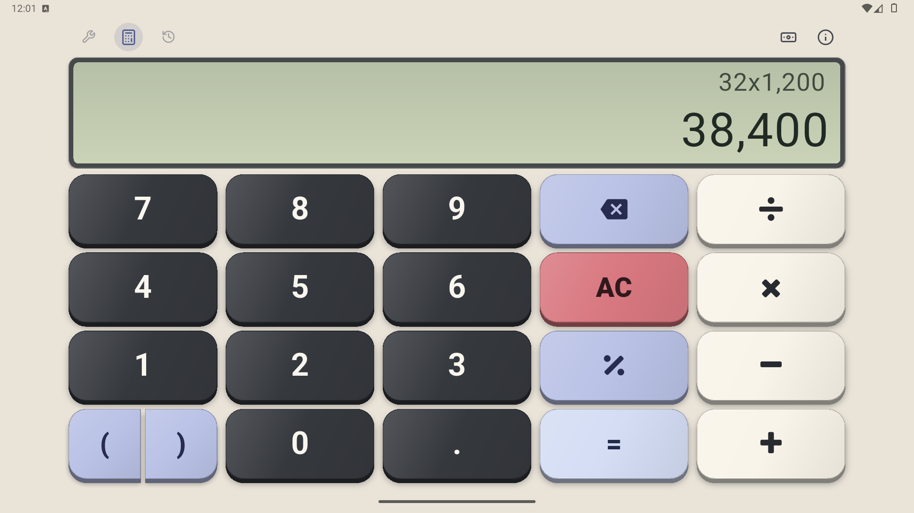
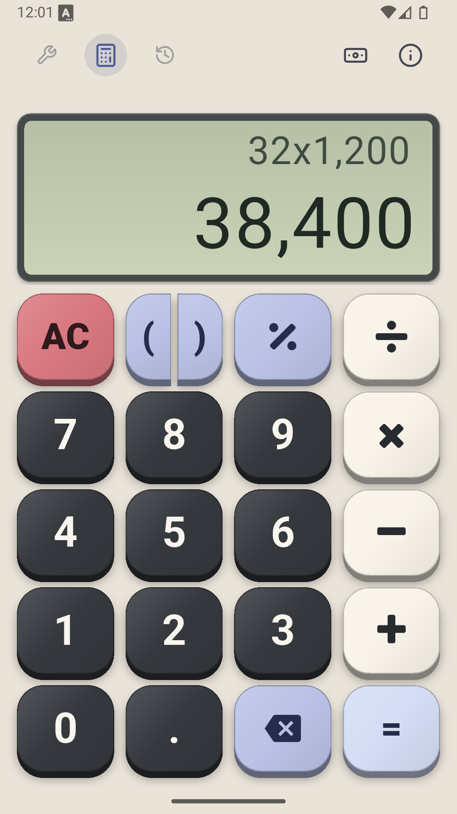
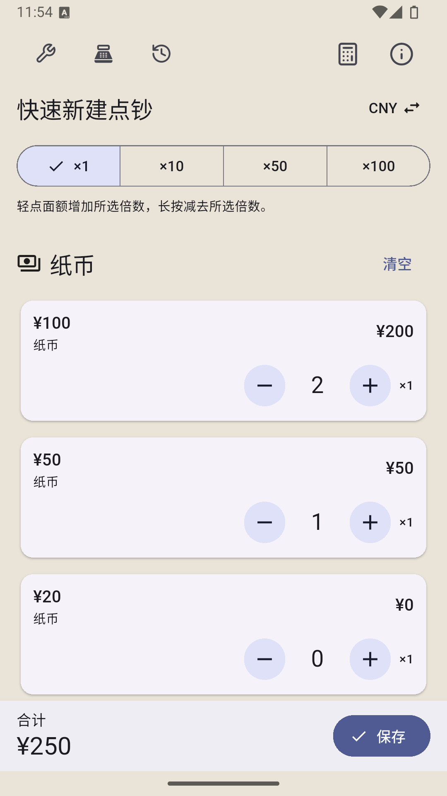
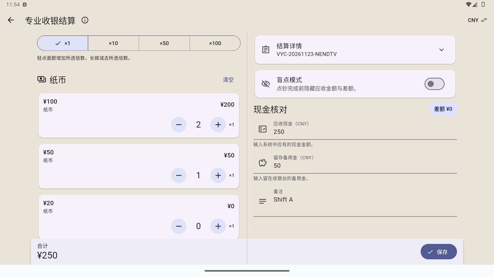

# Keycap Calc

[English](README.md) · 简体中文

一款用 Flutter 开发的安卓计算器和点钞工具，支持横竖屏布局、实体机配色和自定义键帽质感与圆角。

## 界面截图

截图使用 **米白商务（Ivory Desk）**、**3D Keycap** 和 **25 dp** 按键圆角。

### 横屏



### 竖屏



## 功能

- **竖屏四列，横屏五列**，旋转屏幕时保留当前算式。
- **浅色、深色和系统模式**可切换，实体机主题有独立的键帽配色和 LCD 风格显示区。
- **五种按键质感**包括 Original、Flat、2.5D Keycap、3D Keycap 和 Frosted Glass，圆角和字体可分别设置。
- **实时显示结果**，支持括号、百分比和历史记录。短按退格删除一位，长按清空当前算式。
- 支持**快速点钞**和**专业收银结算**。[点钞功能与截图](#现金点钞)

## 现金点钞

点「关于」旁的纸币图标打开「快速新建点钞」。按面额清点纸币和硬币，可按 ×1、×10、×50 或 ×100 批量录入张数与枚数，保存时可以附上备注。货币代码和切换按钮在右上角。

点收银机图标进入「专业收银结算」。可以核对实收与应收、记录备用金、导入 POS 报表和采集签名。开启盲点模式后，应收金额和差额会隐藏到点钞数量锁定为止。已保存的结算可导出 PDF 或 CSV 报表。

在「点钞设置」里可以选择地区和默认货币、调整面额、保存商家资料和收银模板。支持人民币、港币、澳门元、新台币等币种。点钞记录和设置可导出为加密备份，也可从备份恢复。

### 快速点钞竖屏



### 专业收银结算横屏



## 本地运行

已用 Flutter 3.32.8、JDK 17 和 Android SDK Platform 35 验证构建。连接 Android 设备或启动模拟器后运行以下命令。

```bash
git clone https://github.com/a114126541/keycap-calc.git
cd keycap-calc
flutter pub get
flutter run
```

运行 `flutter test` 执行测试。使用 `flutter build apk --release` 构建 APK，输出位于 `build/app/outputs/flutter-apk/`。

若要和原版同时安装，可以构建使用独立包名的预览 APK。

```bash
ORG_GRADLE_PROJECT_calculatorPreview=true flutter build apk --release --target-platform android-arm64
```

## 开源许可与署名

Keycap Calc 由 gospursgo 维护，基于 Mohammed Ragheb 开发的 Neumorphic Calculator。[维护者](https://github.com/a114126541) · [上游项目](https://github.com/mllrr96/Neumorphic-Calculator)

原作者版权声明为 **Copyright (c) 2024 Mohammed Ragheb**。仓库根目录和应用的「开源许可」页都收录了该声明和完整 MIT 许可文本。[LICENSE](LICENSE)

点钞功能基于 Michal Machalik 开发的 Aardvarkland CashTally。仓库和应用的「开源许可」页都附有原版权声明 **Copyright (c) 2026 Michal Machalik** 和完整 MIT 许可文本。[上游源码](https://github.com/MichalMachalik/Aardvarkland-CashTally/tree/778ea7de3a4a96c61f3e3e0ab6cce0be75dffd6b) · [版权声明与 MIT 许可](assets/licenses/Aardvarkland-CashTally.txt)
